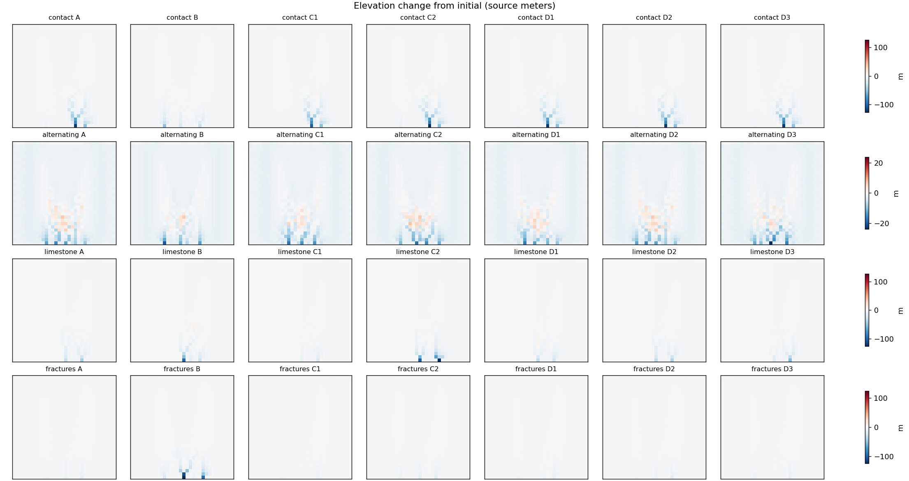
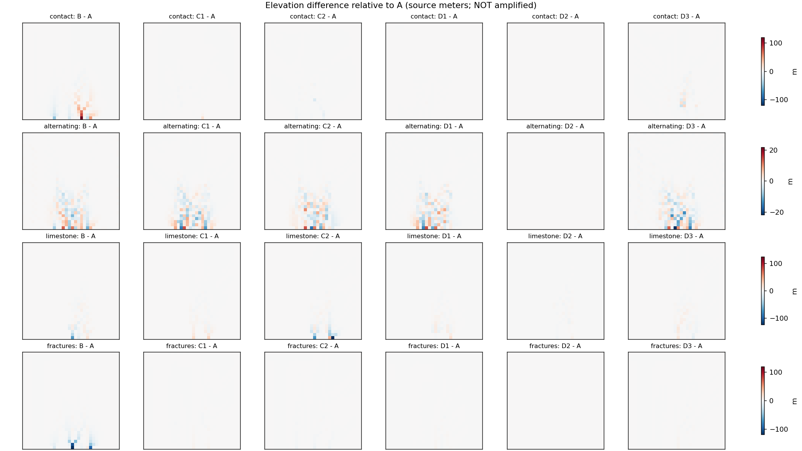
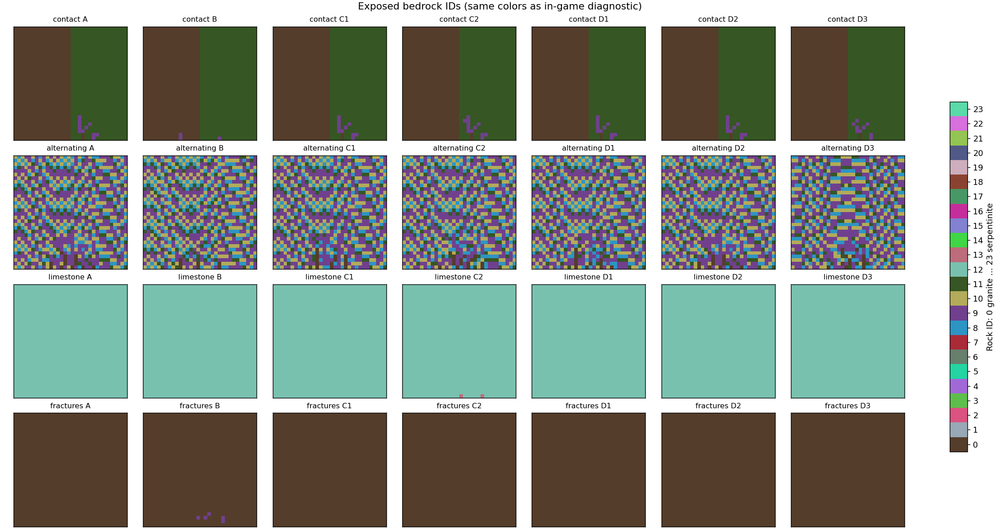

World of History v30 — 岩石・地層・山肌 統合実装報告（2026-11-04）

単一エージェントで実装・検証。作業ブランチ codex/terrain-query-v1。mainへの変更・マージ・Web公開は行っていません。生成バージョン12 / rock-24-v1。実験の数値はソース世界のSI単位です。ゲーム画面の縮尺へ変換した値ではありません。

## 1. 実装した機能と変更ファイル

24岩種の共通カタログ、形成条件に基づく地質区分、有限厚の地層、実効物性、地表流出・浸透・地下水、風化・侵食・溶解・固体土砂の運搬堆積、実標高の更新、露出層、岩肌模様、4種類の地質表示を世界生成へ接続しました。計算は生成時だけ実行します。既存の地殻変動→気候→河川・湖→資源などの処理は残しています。岩石による変形後には気候を再計算し、既存の河川・湖生成に新しい標高を渡します。

| ファイル | 役割 |
| --- | --- |
| src/rocks/catalog.mjs | 24岩種・基本値・地域条件からの実効物性 |
| src/rocks/layers.mjs | 6層の岩柱・傾斜・褶曲・断層・露出更新 |
| src/rocks/evolution.mjs | 保存則を持つ2.5Dの地質年代計算と計測 |
| src/rocks/world-rocks.mjs | 既存地質/気候からの条件抽出・実標高反映・共通参照 |
| src/rocks/rock-material.mjs | 岩肌・鉱物/風化/湿潤/層理模様・診断表示 |
| tools/integrate-rocks.mjs / build-integrated-world.mjs | Worker・保存世代・UI・単一HTMLの統合 |
| src/integration/playable-scale.mjs / third-person.mjs | 同じ標高/岩石を俯瞰と三人称から使用 |
| src/vegetation/grass-placement.mjs | 表土が薄い露岩への草の抑制 |
| src/development/developer-tools.mjs | 岩肌の確認地点・上から下への地層情報 |
| tests/rocks*.mjs / *.cjs, tools/rock-*.mjs, rock-*.py | 数値実験・互換性・GPU照合・再現可能な計測と報告 |

## 2. 24岩種と物性の反映先

密度・圧縮/引張強度・空隙率・基質透水性は幅を持つ代表値です。割れ目・風化・含水・温度・地層傾斜は地域側の別配列で保持します。強度低下、割れ目の三乗則による透水性増加、Darcy則に基づく透水係数、湿潤/凍結/熱拡散に依存する風化を計算します。侵食耐性は機械侵食率の分母へ、密度は土砂/岩盤の質量変換へ、溶解性と反応速度は溶解物の供給上限へ使います。層理と傾斜は侵食の方向依存性とMohr-Coulomb型の安全率に使います。硬度は記述用の参考物性として保持し、岩盤強度の代用にはしていません。鉱物組成は結晶粒の明暗・長石の色味・雲母/粘土の暗部・含鉄鉱物の風化色に反映します。

下表は基本値。単位は密度kg/m³、強度MPa、空隙率は体積比、透水性κはm²、風化はm/年、溶解性はkg/m³です。侵食耐性・風化速度・反応速度・損傷低下係数はゲームモデルの未校正パラメータです。すべてを24岩種別の実測値と主張するものではありません。全項目は同梱 rock-catalog.json にあります。

| ID/岩石 | 密度 | Mohs | UCS | 引張 | 空隙率 | 基質κ | 耐性 | 風化速度 | 溶解性 | 形成条件 |
| --- | --- | --- | --- | --- | --- | --- | --- | --- | --- | --- |
| 0 花崗岩 | [2600, 2750] | [6, 7] | [100, 250] | [7, 20] | [0.001, 0.03] | [1e-21, 1e-17] | 2.2 | 8e-05 | 0.001 | 大陸地殻深部の珪長質マグマの緩慢冷却 |
| 1 閃緑岩 | [2700, 2950] | [6, 7] | [100, 250] | [8, 22] | [0.002, 0.04] | [1e-21, 1e-17] | 2.3 | 9e-05 | 0.001 | 中間質マグマの深成貫入 |
| 2 斑れい岩 | [2900, 3300] | [6, 7] | [100, 300] | [10, 25] | [0.001, 0.025] | [1e-22, 1e-18] | 2.5 | 8e-05 | 0.001 | 苦鉄質マグマの深部結晶化 |
| 3 玄武岩 | [2700, 3100] | [5.5, 6.5] | [80, 300] | [8, 25] | [0.005, 0.12] | [1e-20, 1e-15] | 2.4 | 0.0001 | 0.002 | 海洋地殻・リフト・盾状火山の苦鉄質溶岩 |
| 4 安山岩 | [2500, 2850] | [5.5, 6.5] | [80, 220] | [6, 20] | [0.01, 0.15] | [1e-20, 1e-15] | 1.8 | 0.00014 | 0.002 | 沈み込み帯の中間質火山活動 |
| 5 流紋岩 | [2300, 2700] | [6, 7] | [50, 200] | [4, 16] | [0.01, 0.18] | [1e-20, 1e-15] | 1.6 | 0.00015 | 0.001 | 大陸火山の珪長質噴出 |
| 6 凝灰岩 | [1500, 2400] | [3, 6] | [5, 80] | [0.5, 8] | [0.1, 0.45] | [1e-17, 1e-12] | 0.6 | 0.0004 | 0.003 | 爆発的噴火による火山灰の堆積と固結 |
| 7 黒曜岩 | [2200, 2600] | [5, 5.5] | [40, 150] | [1, 10] | [0.001, 0.03] | [1e-22, 1e-18] | 1.3 | 0.00012 | 0.001 | 珪長質溶岩の急冷した流紋岩溶岩縁 |
| 8 礫岩 | [2000, 2700] | [4, 7] | [20, 150] | [2, 12] | [0.01, 0.25] | [1e-17, 1e-12] | 1.2 | 0.0002 | 0.002 | 造山帯前縁の扇状地・河道の礫質堆積 |
| 9 砂岩 | [1900, 2650] | [4, 7] | [20, 170] | [1, 15] | [0.05, 0.3] | [1e-17, 1e-12] | 1.2 | 0.00018 | 0.003 | 陸棚・海浜・河川・砂漠の砂質堆積 |
| 10 泥岩 | [2000, 2600] | [2, 4] | [5, 60] | [0.3, 5] | [0.05, 0.25] | [1e-22, 1e-18] | 0.45 | 0.00045 | 0.003 | 静穏な湖盆・氾濫原・海盆の泥質堆積 |
| 11 頁岩 | [2000, 2700] | [2, 4] | [5, 100] | [0.3, 7] | [0.03, 0.2] | [1e-22, 1e-18] | 0.5 | 0.0004 | 0.003 | 圧密した海盆泥の薄層と剥離性 |
| 12 石灰岩 | [2200, 2800] | [3, 4] | [30, 180] | [2, 15] | [0.005, 0.25] | [1e-21, 1e-15] | 1.4 | 0.0001 | 0.12 | 暖かい浅海の炭酸塩堆積 |
| 13 ドロマイト岩 | [2500, 2900] | [3.5, 4.5] | [50, 220] | [3, 18] | [0.005, 0.2] | [1e-21, 1e-15] | 1.7 | 8e-05 | 0.05 | 炭酸塩堆積物の苦灰石化 |
| 14 チャート | [2400, 2700] | [6.5, 7] | [100, 300] | [8, 25] | [0.001, 0.08] | [1e-23, 1e-19] | 3 | 3e-05 | 0.0001 | 遠洋の珪質生物堆積と続成作用 |
| 15 石膏岩 | [1800, 2400] | [1.5, 2.5] | [5, 40] | [0.3, 4] | [0.01, 0.3] | [1e-22, 1e-16] | 0.25 | 0.00035 | 2.4 | 閉鎖性乾燥盆地の蒸発濃縮 |
| 16 岩塩 | [2000, 2200] | [2, 2.5] | [10, 50] | [0.3, 3] | [0.001, 0.05] | [1e-24, 1e-20] | 0.2 | 0.0002 | 360 | 蒸発岩盆地の強い蒸発・塩水濃縮 |
| 17 片麻岩 | [2600, 2900] | [5.5, 7] | [80, 250] | [4, 18] | [0.001, 0.04] | [1e-22, 1e-18] | 2 | 8e-05 | 0.001 | 大陸地殻の高温・高変成度 |
| 18 結晶片岩 | [2500, 2900] | [3.5, 6] | [20, 120] | [1, 8] | [0.005, 0.08] | [1e-22, 1e-17] | 1 | 0.00025 | 0.002 | 泥質原岩の中変成度・片理形成 |
| 19 粘板岩 | [2600, 2900] | [3, 5] | [40, 160] | [2, 12] | [0.002, 0.06] | [1e-23, 1e-18] | 1.4 | 0.00016 | 0.002 | 泥岩・頁岩の低度変成 |
| 20 千枚岩 | [2500, 2850] | [3, 5] | [20, 100] | [1, 8] | [0.005, 0.08] | [1e-22, 1e-17] | 0.9 | 0.00024 | 0.002 | 粘板岩と結晶片岩の中間の変成度 |
| 21 大理石 | [2500, 2850] | [3, 4] | [50, 150] | [3, 12] | [0.001, 0.05] | [1e-22, 1e-17] | 1.3 | 9e-05 | 0.12 | 炭酸塩岩の接触・広域変成 |
| 22 珪岩 | [2600, 2800] | [6.5, 7] | [100, 300] | [8, 25] | [0.001, 0.03] | [1e-23, 1e-19] | 3 | 3e-05 | 0.0001 | 石英質砂岩の再結晶 |
| 23 蛇紋岩 | [2400, 2800] | [3, 5.5] | [20, 150] | [1, 10] | [0.005, 0.12] | [1e-22, 1e-17] | 0.9 | 0.00021 | 0.02 | 苦鉄質・超苦鉄質岩への熱水付加・蛇紋岩化 |

文献の参照範囲：岩石試料のUCSの代表的な大小関係はRockmassの試験集計表と照合しました。USGSの空隙率・密度/熱物性の報告は条件依存性を考慮するための参考です。蒸発岩の溶解には水と流出経路が必要というUSGSの整理に合わせ、濡れたら無条件に消す方式は採用していません。今回はpH・CO₂・イオン活量まで解く反応輸送モデルではありません。

- [Rockmass: 試料の一軸圧縮強度の集計](https://rockmass.net/files/strength_and_deform_values%20.pdf)

- [USGS Manger: Porosity and bulk density of sedimentary rocks](https://pubs.usgs.gov/publication/b1144E)

- [USGS Robertson: Thermal properties of rocks](https://pubs.usgs.gov/publication/ofr88441)

- [USGS Johnson: Evaporite dissolution](https://www.usgs.gov/publications/subsidence-hazards-due-evaporite-dissolution-united-states)

## 3. A〜Dの比較実験

4地形とも32×32、格子40m、Seed1729、1万年・64ステップ。実験ごとに初期入力のSHA-256を照合しています。入力標高・降水・気温・初期水分/地層・境界条件・計算法を固定し、流路・地下水・露出の変化は結果として許しています。周囲と海への境界は開放。地表の流路は窪地をpriority floodで排水可能にし、岩盤を上り坂へ削る計算は行いません。世界全体の20万年・32ステップとは格子規模が異なり、小さな地形には短い時間刻みを使っています。

| 実験 | 唯一の変更 |
| --- | --- |
| A | 固有の全物性 |
| B | 岩石名/層位置を維持し、地形に働く基本物性を全岩種共通の中間値に統一 |
| C1/C2 | 対象岩種の侵食耐性だけ1.5倍 / 1÷1.5倍 |
| D1 | 実効透水性だけ全岩種2倍 |
| D2 | 石灰岩ID12の溶解性だけ2倍（反応速度上限は固定） |
| D3 | 傾斜角25°・方向90°だけに変更。互層では初期地表IDが750/1024セル変化 |

| 地形 / Cの対象 | A 対象の機械侵食(Mkg) | C1 | A比 | C2 | A比 |
| --- | --- | --- | --- | --- | --- |
| contact / 花崗岩 | 543.38792 | 398.60395 | -26.64% | 727.45523 | +33.87% |
| alternating / 砂岩 | 287.23625 | 229.12036 | -20.23% | 382.69798 | +33.23% |
| limestone / 石灰岩 | 1218.37118 | 564.89408 | -53.64% | 3060.68722 | +151.21% |
| fractures / 花崗岩 | 1006.75733 | 811.26963 | -19.42% | 1325.14548 | +31.63% |

Cでは対象岩種の侵食の増減が4地形すべてで予想する向きになりました。ただし領域全体の標高差や総侵食量は、下位層の露出、表土の保護、流路・堆積の変化も含むため、対象岩種だけの値と比例しません。Bの均一化でも、必ず侵食が増えるという前提は置いていません。

| 地形 | D1 浸透のA比 | D1 表面流出のA比 | D2 溶解のA比 | D3 初期ID変更 | D3 流路変更割合 |
| --- | --- | --- | --- | --- | --- |
| contact | +59.53% | -0.35% | +0.00% | 0/1024 | 7.42% |
| alternating | +22.42% | -19.43% | +0.00% | 750/1024 | 13.67% |
| limestone | +70.83% | -3.76% | +99.88% | 0/1024 | 7.52% |
| fractures | +90.20% | -4.65% | +0.00% | 0/1024 | 4.20% |

D1は浸透を増やし地表流出を減らします。地下へ入った水は保存量と基底流へ分け、消失させていません。D2では湿潤/乾燥石灰岩の溶解量がほぼ2倍になりました。他の3地形には対象の石灰岩がないため差は0で、差を演出する補正は入れていません。D3の互層では初期岩石分布も変わるので「同じ岩種で傾斜だけの力学効果」とは解釈できません。明示柱を持つ他の地形では初期IDは同じで、方向依存性の影響を比較できます。

## 4. 標高・斜面・谷・水・土砂の数値比較

各セルは「値 / Aとの差 / A比」。Aが0のとき率は出しません。谷は集水セル数8以上の流路に対し左右4セルの断面を取り、岸の平均標高からの深さと半深度の幅を求めた格子上の代理指標です。実地の谷幅の測定やカルスト洞窟の解析ではありません。流路密度は流路セル数×格子間隔/陸面積です。

### contact

| 指標 | A | B | C1 | C2 | D1 | D2 | D3 |
| --- | --- | --- | --- | --- | --- | --- | --- |
| 総岩盤除去kg | 1.0811e+10 / Δ 0 / +0.00% | 8.2991e+09 / Δ -2.512e+09 / -23.24% | 1.0669e+10 / Δ -1.4181e+08 / -1.31% | 1.111e+10 / Δ 2.987e+08 / +2.76% | 1.0815e+10 / Δ 4.1814e+06 / +0.04% | 1.0811e+10 / Δ 0 / +0.00% | 1.0747e+10 / Δ -6.3961e+07 / -0.59% |
| 平均Δ標高m | -2.03836 / Δ 0 / +0.00% | -1.53353 / Δ 0.50483 / -24.77% | -2.01117 / Δ 0.02719 / -1.33% | -2.10533 / Δ -0.06697 / +3.29% | -2.03528 / Δ 0.00308 / -0.15% | -2.03836 / Δ 0 / +0.00% | -2.03339 / Δ 0.00497 / -0.24% |
| 最大/Δ標高/m | 121.36319 / Δ 0 / +0.00% | 51.86601 / Δ -69.49718 / -57.26% | 103.82752 / Δ -17.53567 / -14.45% | 126.77455 / Δ 5.41135 / +4.46% | 121.34771 / Δ -0.01548 / -0.01% | 121.36319 / Δ 0 / +0.00% | 119.94683 / Δ -1.41636 / -1.17% |
| 平均傾斜° | 7.36972 / Δ 0 / +0.00% | 6.80854 / Δ -0.56118 / -7.61% | 7.33513 / Δ -0.03459 / -0.47% | 7.42893 / Δ 0.05921 / +0.80% | 7.36964 / Δ -8.1049e-05 / -0.00% | 7.36972 / Δ 0 / +0.00% | 7.34732 / Δ -0.0224 / -0.30% |
| p90傾斜° | 7.69111 / Δ 0 / +0.00% | 7.50901 / Δ -0.1821 / -2.37% | 7.69097 / Δ -0.00014455 / -0.00% | 7.82972 / Δ 0.13861 / +1.80% | 7.69099 / Δ -0.00012463 / -0.00% | 7.69111 / Δ 0 / +0.00% | 7.70281 / Δ 0.0117 / +0.15% |
| 35°以上割合 | 0.01172 / Δ 0 / +0.00% | 0.00097656 / Δ -0.01074 / -91.67% | 0.01074 / Δ -0.00097656 / -8.33% | 0.01172 / Δ 0 / +0.00% | 0.01172 / Δ 0 / +0.00% | 0.01172 / Δ 0 / +0.00% | 0.01074 / Δ -0.00097656 / -8.33% |
| 谷深m | 5.93389 / Δ 0 / +0.00% | 4.60148 / Δ -1.33241 / -22.45% | 5.80277 / Δ -0.13113 / -2.21% | 6.35233 / Δ 0.41844 / +7.05% | 5.86144 / Δ -0.07245 / -1.22% | 5.93389 / Δ 0 / +0.00% | 5.98011 / Δ 0.04621 / +0.78% |
| 谷幅m | 232.11066 / Δ 0 / +0.00% | 238.02315 / Δ 5.91249 / +2.55% | 234.50972 / Δ 2.39905 / +1.03% | 233.81346 / Δ 1.7028 / +0.73% | 233.47516 / Δ 1.36449 / +0.59% | 232.11066 / Δ 0 / +0.00% | 233.99483 / Δ 1.88417 / +0.81% |
| 流路密度1/m | 0.00701 / Δ 0 / +0.00% | 0.00779 / Δ 0.00078125 / +11.15% | 0.00713 / Δ 0.00012207 / +1.74% | 0.00696 / Δ -4.8828e-05 / -0.70% | 0.0072 / Δ 0.00019531 / +2.79% | 0.00701 / Δ 0 / +0.00% | 0.00698 / Δ -2.4414e-05 / -0.35% |
| 浸透m³ | 9.9024e+07 / Δ 0 / +0.00% | 5.5395e+07 / Δ -4.3628e+07 / -44.06% | 9.9429e+07 / Δ 405304.96903 / +0.41% | 9.9226e+07 / Δ 202685.82618 / +0.20% | 1.5797e+08 / Δ 5.8946e+07 / +59.53% | 9.9024e+07 / Δ 0 / +0.00% | 8.7675e+07 / Δ -1.1349e+07 / -11.46% |
| 地表流出m³ | 1.7071e+10 / Δ 0 / +0.00% | 1.7115e+10 / Δ 4.3628e+07 / +0.26% | 1.7071e+10 / Δ -405304.96903 / -0.00% | 1.7071e+10 / Δ -202685.82618 / -0.00% | 1.7012e+10 / Δ -5.8946e+07 / -0.35% | 1.7071e+10 / Δ 0 / +0.00% | 1.7083e+10 / Δ 1.1349e+07 / +0.07% |
| 溶解kg | 247169.7342 / Δ 0 / +0.00% | 609239.54937 / Δ 362069.81517 / +146.49% | 248501.70513 / Δ 1331.97092 / +0.54% | 248044.68623 / Δ 874.95203 / +0.35% | 382596.39576 / Δ 135426.66156 / +54.79% | 247169.7342 / Δ 0 / +0.00% | 232485.7937 / Δ -14683.9405 / -5.94% |
| 累積再堆積kg | 2.5947e+09 / Δ 0 / +0.00% | 1.3879e+09 / Δ -1.2069e+09 / -46.51% | 2.4044e+09 / Δ -1.9034e+08 / -7.34% | 2.8256e+09 / Δ 2.309e+08 / +8.90% | 2.6042e+09 / Δ 9.499e+06 / +0.37% | 2.5947e+09 / Δ 0 / +0.00% | 2.4971e+09 / Δ -9.7595e+07 / -3.76% |
| 固体域外流出kg | 9.0483e+09 / Δ 0 / +0.00% | 7.1112e+09 / Δ -1.9371e+09 / -21.41% | 8.9214e+09 / Δ -1.2692e+08 / -1.40% | 9.3317e+09 / Δ 2.8344e+08 / +3.13% | 9.0415e+09 / Δ -6.8192e+06 / -0.08% | 9.0483e+09 / Δ 0 / +0.00% | 9.016e+09 / Δ -3.231e+07 / -0.36% |

### alternating

| 指標 | A | B | C1 | C2 | D1 | D2 | D3 |
| --- | --- | --- | --- | --- | --- | --- | --- |
| 総岩盤除去kg | 8.8429e+09 / Δ 0 / +0.00% | 7.5665e+09 / Δ -1.2765e+09 / -14.43% | 8.8655e+09 / Δ 2.2613e+07 / +0.26% | 8.9644e+09 / Δ 1.2144e+08 / +1.37% | 8.8896e+09 / Δ 4.6696e+07 / +0.53% | 8.8429e+09 / Δ 0 / +0.00% | 9.085e+09 / Δ 2.4208e+08 / +2.74% |
| 平均Δ標高m | -1.31596 / Δ 0 / +0.00% | -1.28949 / Δ 0.02647 / -2.01% | -1.38531 / Δ -0.06934 / +5.27% | -1.34687 / Δ -0.03091 / +2.35% | -1.32777 / Δ -0.01181 / +0.90% | -1.31596 / Δ 0 / +0.00% | -1.44207 / Δ -0.12611 / +9.58% |
| 最大/Δ標高/m | 14.97288 / Δ 0 / +0.00% | 20.00313 / Δ 5.03025 / +33.60% | 17.15936 / Δ 2.18648 / +14.60% | 17.89504 / Δ 2.92216 / +19.52% | 16.79867 / Δ 1.82579 / +12.19% | 14.97288 / Δ 0 / +0.00% | 23.9133 / Δ 8.94042 / +59.71% |
| 平均傾斜° | 6.61471 / Δ 0 / +0.00% | 6.57372 / Δ -0.04098 / -0.62% | 6.61121 / Δ -0.0035 / -0.05% | 6.62285 / Δ 0.00814 / +0.12% | 6.58347 / Δ -0.03124 / -0.47% | 6.61471 / Δ 0 / +0.00% | 6.66207 / Δ 0.04736 / +0.72% |
| p90傾斜° | 7.55929 / Δ 0 / +0.00% | 7.36341 / Δ -0.19588 / -2.59% | 7.45181 / Δ -0.10749 / -1.42% | 7.54668 / Δ -0.01262 / -0.17% | 7.4904 / Δ -0.0689 / -0.91% | 7.55929 / Δ 0 / +0.00% | 7.63007 / Δ 0.07077 / +0.94% |
| 35°以上割合 | 0 / Δ 0 / 率なし | 0 / Δ 0 / 率なし | 0 / Δ 0 / 率なし | 0 / Δ 0 / 率なし | 0 / Δ 0 / 率なし | 0 / Δ 0 / 率なし | 0 / Δ 0 / 率なし |
| 谷深m | 4.42927 / Δ 0 / +0.00% | 4.25311 / Δ -0.17616 / -3.98% | 4.43306 / Δ 0.00378 / +0.09% | 4.5137 / Δ 0.08442 / +1.91% | 4.37493 / Δ -0.05435 / -1.23% | 4.42927 / Δ 0 / +0.00% | 4.57812 / Δ 0.14885 / +3.36% |
| 谷幅m | 243.26376 / Δ 0 / +0.00% | 239.36363 / Δ -3.90013 / -1.60% | 237.30833 / Δ -5.95543 / -2.45% | 238.04042 / Δ -5.22333 / -2.15% | 237.93466 / Δ -5.3291 / -2.19% | 243.26376 / Δ 0 / +0.00% | 232.95098 / Δ -10.31277 / -4.24% |
| 流路密度1/m | 0.0072 / Δ 0 / +0.00% | 0.00728 / Δ 7.3242e-05 / +1.02% | 0.00742 / Δ 0.00021973 / +3.05% | 0.00728 / Δ 7.3242e-05 / +1.02% | 0.00747 / Δ 0.00026855 / +3.73% | 0.0072 / Δ 0 / +0.00% | 0.00725 / Δ 4.8828e-05 / +0.68% |
| 浸透m³ | 7.973e+09 / Δ 0 / +0.00% | 5.5395e+07 / Δ -7.9176e+09 / -99.31% | 7.9952e+09 / Δ 2.2293e+07 / +0.28% | 7.9622e+09 / Δ -1.074e+07 / -0.13% | 9.7603e+09 / Δ 1.7873e+09 / +22.42% | 7.973e+09 / Δ 0 / +0.00% | 7.9655e+09 / Δ -7.4978e+06 / -0.09% |
| 地表流出m³ | 9.1975e+09 / Δ 0 / +0.00% | 1.7115e+10 / Δ 7.9176e+09 / +86.08% | 9.1752e+09 / Δ -2.2293e+07 / -0.24% | 9.2082e+09 / Δ 1.074e+07 / +0.12% | 7.4102e+09 / Δ -1.7873e+09 / -19.43% | 9.1975e+09 / Δ 0 / +0.00% | 9.205e+09 / Δ 7.4978e+06 / +0.08% |
| 溶解kg | 2.2904e+07 / Δ 0 / +0.00% | 609212.2531 / Δ -2.2295e+07 / -97.34% | 2.3013e+07 / Δ 109227.83333 / +0.48% | 2.2839e+07 / Δ -64755.67436 / -0.28% | 2.8049e+07 / Δ 5.145e+06 / +22.46% | 2.2904e+07 / Δ 0 / +0.00% | 2.2909e+07 / Δ 5148.26006 / +0.02% |
| 累積再堆積kg | 3.5306e+09 / Δ 0 / +0.00% | 1.9573e+09 / Δ -1.5733e+09 / -44.56% | 2.8614e+09 / Δ -6.6922e+08 / -18.95% | 3.5099e+09 / Δ -2.0691e+07 / -0.59% | 3.1288e+09 / Δ -4.0186e+08 / -11.38% | 3.5306e+09 / Δ 0 / +0.00% | 3.557e+09 / Δ 2.6392e+07 / +0.75% |
| 固体域外流出kg | 6.1515e+09 / Δ 0 / +0.00% | 6.1986e+09 / Δ 4.7097e+07 / +0.77% | 6.3429e+09 / Δ 1.9138e+08 / +3.11% | 6.2734e+09 / Δ 1.219e+08 / +1.98% | 6.1926e+09 / Δ 4.1154e+07 / +0.67% | 6.1515e+09 / Δ 0 / +0.00% | 6.5628e+09 / Δ 4.1132e+08 / +6.69% |

### limestone

| 指標 | A | B | C1 | C2 | D1 | D2 | D3 |
| --- | --- | --- | --- | --- | --- | --- | --- |
| 総岩盤除去kg | 6.1051e+09 / Δ 0 / +0.00% | 7.312e+09 / Δ 1.2069e+09 / +19.77% | 5.4986e+09 / Δ -6.0651e+08 / -9.93% | 8.0695e+09 / Δ 1.9644e+09 / +32.18% | 5.9311e+09 / Δ -1.7396e+08 / -2.85% | 6.1538e+09 / Δ 4.8716e+07 / +0.80% | 6.1896e+09 / Δ 8.4476e+07 / +1.38% |
| 平均Δ標高m | -0.96755 / Δ 0 / +0.00% | -0.97364 / Δ -0.00609 / +0.63% | -0.82914 / Δ 0.13841 / -14.31% | -1.41841 / Δ -0.45086 / +46.60% | -0.9151 / Δ 0.05245 / -5.42% | -0.98707 / Δ -0.01952 / +2.02% | -0.92719 / Δ 0.04036 / -4.17% |
| 最大/Δ標高/m | 43.92972 / Δ 0 / +0.00% | 99.2763 / Δ 55.34658 / +125.99% | 18.21738 / Δ -25.71233 / -58.53% | 126.71219 / Δ 82.78248 / +188.44% | 30.86312 / Δ -13.0666 / -29.74% | 38.92637 / Δ -5.00335 / -11.39% | 55.54843 / Δ 11.61871 / +26.45% |
| 平均傾斜° | 6.70236 / Δ 0 / +0.00% | 6.91628 / Δ 0.21391 / +3.19% | 6.48842 / Δ -0.21394 / -3.19% | 7.30238 / Δ 0.60001 / +8.95% | 6.62673 / Δ -0.07563 / -1.13% | 6.70264 / Δ 0.00027674 / +0.00% | 6.69597 / Δ -0.0064 / -0.10% |
| p90傾斜° | 7.48956 / Δ 0 / +0.00% | 7.49121 / Δ 0.00165 / +0.02% | 7.41434 / Δ -0.07522 / -1.00% | 7.49646 / Δ 0.00689 / +0.09% | 7.44834 / Δ -0.04122 / -0.55% | 7.49103 / Δ 0.00146 / +0.02% | 7.49103 / Δ 0.00146 / +0.02% |
| 35°以上割合 | 0 / Δ 0 / 率なし | 0.00488 / Δ 0.00488 / 率なし | 0 / Δ 0 / 率なし | 0.01172 / Δ 0.01172 / 率なし | 0 / Δ 0 / 率なし | 0 / Δ 0 / 率なし | 0.00195 / Δ 0.00195 / 率なし |
| 谷深m | 4.09925 / Δ 0 / +0.00% | 4.51361 / Δ 0.41436 / +10.11% | 3.54354 / Δ -0.55571 / -13.56% | 5.51534 / Δ 1.41609 / +34.55% | 3.90577 / Δ -0.19348 / -4.72% | 4.07509 / Δ -0.02416 / -0.59% | 4.03659 / Δ -0.06266 / -1.53% |
| 谷幅m | 224.08982 / Δ 0 / +0.00% | 230.63099 / Δ 6.54117 / +2.92% | 225.44437 / Δ 1.35454 / +0.60% | 223.99641 / Δ -0.09341 / -0.04% | 225.06593 / Δ 0.97611 / +0.44% | 226.36391 / Δ 2.27408 / +1.01% | 226.87401 / Δ 2.78419 / +1.24% |
| 流路密度1/m | 0.0075 / Δ 0 / +0.00% | 0.00771 / Δ 0.00021973 / +2.93% | 0.00779 / Δ 0.00029297 / +3.91% | 0.00745 / Δ -4.8828e-05 / -0.65% | 0.00776 / Δ 0.00026855 / +3.58% | 0.00752 / Δ 2.4414e-05 / +0.33% | 0.00762 / Δ 0.00012207 / +1.63% |
| 浸透m³ | 5.6806e+08 / Δ 0 / +0.00% | 5.6806e+08 / Δ 0 / +0.00% | 5.6806e+08 / Δ 0 / +0.00% | 5.6806e+08 / Δ 0 / +0.00% | 9.7042e+08 / Δ 4.0236e+08 / +70.83% | 5.6806e+08 / Δ 0 / +0.00% | 5.6806e+08 / Δ 0 / +0.00% |
| 地表流出m³ | 1.0704e+10 / Δ 0 / +0.00% | 1.0704e+10 / Δ 0 / +0.00% | 1.0704e+10 / Δ 0 / +0.00% | 1.0704e+10 / Δ 0 / +0.00% | 1.0302e+10 / Δ -4.0236e+08 / -3.76% | 1.0704e+10 / Δ 0 / +0.00% | 1.0704e+10 / Δ 0 / +0.00% |
| 溶解kg | 7.4963e+07 / Δ 0 / +0.00% | 6.2449e+06 / Δ -6.8718e+07 / -91.67% | 7.4968e+07 / Δ 5564.90039 / +0.01% | 7.4927e+07 / Δ -35681.79758 / -0.05% | 1.2793e+08 / Δ 5.297e+07 / +70.66% | 1.4984e+08 / Δ 7.4872e+07 / +99.88% | 7.4859e+07 / Δ -104251.7316 / -0.14% |
| 累積再堆積kg | 1.3995e+09 / Δ 0 / +0.00% | 1.8257e+09 / Δ 4.2614e+08 / +30.45% | 1.0536e+09 / Δ -3.4593e+08 / -24.72% | 1.4822e+09 / Δ 8.2657e+07 / +5.91% | 1.3289e+09 / Δ -7.0587e+07 / -5.04% | 1.3585e+09 / Δ -4.0996e+07 / -2.93% | 1.6425e+09 / Δ 2.4301e+08 / +17.36% |
| 固体域外流出kg | 4.6592e+09 / Δ 0 / +0.00% | 5.2702e+09 / Δ 6.1093e+08 / +13.11% | 4.0781e+09 / Δ -5.8118e+08 / -12.47% | 6.5545e+09 / Δ 1.8952e+09 / +40.68% | 4.4061e+09 / Δ -2.5309e+08 / -5.43% | 4.6531e+09 / Δ -6.1671e+06 / -0.13% | 4.584e+09 / Δ -7.5285e+07 / -1.62% |

### fractures

| 指標 | A | B | C1 | C2 | D1 | D2 | D3 |
| --- | --- | --- | --- | --- | --- | --- | --- |
| 総岩盤除去kg | 6.3991e+09 / Δ 0 / +0.00% | 1.0406e+10 / Δ 4.0067e+09 / +62.61% | 6.2344e+09 / Δ -1.6462e+08 / -2.57% | 6.6765e+09 / Δ 2.7745e+08 / +4.34% | 6.349e+09 / Δ -5.0019e+07 / -0.78% | 6.3991e+09 / Δ 0 / +0.00% | 6.3728e+09 / Δ -2.6277e+07 / -0.41% |
| 平均Δ標高m | -1.26824 / Δ 0 / +0.00% | -2.01671 / Δ -0.74847 / +59.02% | -1.2341 / Δ 0.03414 / -2.69% | -1.32659 / Δ -0.05835 / +4.60% | -1.25405 / Δ 0.01419 / -1.12% | -1.26824 / Δ 0 / +0.00% | -1.2587 / Δ 0.00954 / -0.75% |
| 最大/Δ標高/m | 9.69157 / Δ 0 / +0.00% | 123.96807 / Δ 114.2765 / +1179.13% | 6.28932 / Δ -3.40225 / -35.11% | 12.94317 / Δ 3.2516 / +33.55% | 8.54906 / Δ -1.14252 / -11.79% | 9.69157 / Δ 0 / +0.00% | 8.82905 / Δ -0.86252 / -8.90% |
| 平均傾斜° | 6.4553 / Δ 0 / +0.00% | 7.38366 / Δ 0.92836 / +14.38% | 6.42979 / Δ -0.0255 / -0.40% | 6.50267 / Δ 0.04738 / +0.73% | 6.44466 / Δ -0.01064 / -0.16% | 6.4553 / Δ 0 / +0.00% | 6.44324 / Δ -0.01205 / -0.19% |
| p90傾斜° | 7.34441 / Δ 0 / +0.00% | 7.76749 / Δ 0.42308 / +5.76% | 7.32574 / Δ -0.01867 / -0.25% | 7.37113 / Δ 0.02672 / +0.36% | 7.34431 / Δ -9.5484e-05 / -0.00% | 7.34441 / Δ 0 / +0.00% | 7.34315 / Δ -0.00126 / -0.02% |
| 35°以上割合 | 0 / Δ 0 / 率なし | 0.01074 / Δ 0.01074 / 率なし | 0 / Δ 0 / 率なし | 0 / Δ 0 / 率なし | 0 / Δ 0 / 率なし | 0 / Δ 0 / 率なし | 0 / Δ 0 / 率なし |
| 谷深m | 3.17799 / Δ 0 / +0.00% | 6.1723 / Δ 2.99431 / +94.22% | 3.11884 / Δ -0.05915 / -1.86% | 3.32614 / Δ 0.14815 / +4.66% | 3.16264 / Δ -0.01535 / -0.48% | 3.17799 / Δ 0 / +0.00% | 3.12469 / Δ -0.0533 / -1.68% |
| 谷幅m | 233.02608 / Δ 0 / +0.00% | 232.04367 / Δ -0.98241 / -0.42% | 229.57677 / Δ -3.44931 / -1.48% | 228.61607 / Δ -4.41001 / -1.89% | 233.54541 / Δ 0.51933 / +0.22% | 233.02608 / Δ 0 / +0.00% | 229.22092 / Δ -3.80516 / -1.63% |
| 流路密度1/m | 0.00823 / Δ 0 / +0.00% | 0.00715 / Δ -0.00107 / -13.06% | 0.00879 / Δ 0.00056152 / +6.82% | 0.00823 / Δ 0 / +0.00% | 0.00835 / Δ 0.00012207 / +1.48% | 0.00823 / Δ 0 / +0.00% | 0.00864 / Δ 0.00041504 / +5.04% |
| 浸透m³ | 8.4208e+08 / Δ 0 / +0.00% | 8.4902e+08 / Δ 6.9442e+06 / +0.82% | 8.4208e+08 / Δ 0 / +0.00% | 8.4208e+08 / Δ 0 / +0.00% | 1.6017e+09 / Δ 7.5958e+08 / +90.20% | 8.4208e+08 / Δ 0 / +0.00% | 8.4208e+08 / Δ 0 / +0.00% |
| 地表流出m³ | 1.6328e+10 / Δ 0 / +0.00% | 1.6321e+10 / Δ -6.9442e+06 / -0.04% | 1.6328e+10 / Δ 0 / +0.00% | 1.6328e+10 / Δ 0 / +0.00% | 1.5569e+10 / Δ -7.5958e+08 / -4.65% | 1.6328e+10 / Δ 0 / +0.00% | 1.6328e+10 / Δ 0 / +0.00% |
| 溶解kg | 926206.43223 / Δ 0 / +0.00% | 9.3371e+06 / Δ 8.4109e+06 / +908.10% | 926206.43223 / Δ 0 / +0.00% | 926206.43223 / Δ 0 / +0.00% | 1.7617e+06 / Δ 835535.64804 / +90.21% | 926206.43223 / Δ 0 / +0.00% | 926206.43223 / Δ 0 / +0.00% |
| 累積再堆積kg | 6.3216e+08 / Δ 0 / +0.00% | 1.1953e+09 / Δ 5.6311e+08 / +89.08% | 5.918e+08 / Δ -4.0363e+07 / -6.38% | 8.6721e+08 / Δ 2.3505e+08 / +37.18% | 6.6019e+08 / Δ 2.8027e+07 / +4.43% | 6.3216e+08 / Δ 0 / +0.00% | 7.4756e+08 / Δ 1.1539e+08 / +18.25% |
| 固体域外流出kg | 5.8953e+09 / Δ 0 / +0.00% | 9.154e+09 / Δ 3.2587e+09 / +55.28% | 5.7396e+09 / Δ -1.5565e+08 / -2.64% | 6.1597e+09 / Δ 2.6447e+08 / +4.49% | 5.8371e+09 / Δ -5.8142e+07 / -0.99% | 5.8953e+09 / Δ 0 / +0.00% | 5.8597e+09 / Δ -3.5566e+07 / -0.60% |

質量収支は「初期表土＋岩盤から除去した質量＝最終表土＋固体域外流出＋溶解域外流出」。風化で岩盤を土へ変えた質量を二重に流出へ加えません。累積運搬/再堆積は同じ粒子の再移動を含み、正味の物質増加ではありません。溶解物は固体土砂と別に移送・域外排出します。

28実験の最大相対収支誤差：物質 2.729e-13、水 1.6681e-15。NaN/無限大/負の残存層厚は数値テストで検出対象にしています。風化の表土遮蔽は局所解析式で積分し、均一な平面の1ステップ対64ステップで風化質量の一致も検証しました。

## 5. 岩石別侵食・露出の変化

by-rock.csv に28実験×24岩種の除去質量、除去体積、平均侵食深、露出面積、そのAとの差を保存しています。平均侵食深は「その岩種が除去計算の対象になったセル（削れなかったセルも含む）」での平均で、初期の全面積で割った値ではありません。32区間の対数深度ヒストグラムは侵食イベントの分布で、地形全体の最終高度分布とは別です。experiments.json に全ビンと岩種別の機械侵食/風化/溶解を格納しています。

| contact A 岩石 | 除去kg | 除去m³ | 平均深m | 露岩面積m² | 表土下含む分布m² |
| --- | --- | --- | --- | --- | --- |
| 花崗岩 | 3.3011e+09 | 1.2341e+06 | 1.50056 | 793600 | 822400 |
| 砂岩 | 8.1493e+08 | 358210.96026 | 17.22168 | 14400 | 17600 |
| 頁岩 | 6.695e+09 | 2.8489e+06 | 3.4777 | 102400 | 798400 |

| alternating A 岩石 | 除去kg | 除去m³ | 平均深m | 露岩面積m² | 表土下含む分布m² |
| --- | --- | --- | --- | --- | --- |
| 花崗岩 | 9.0233e+07 | 33731.94076 | 1.62173 | 19200 | 20800 |
| 礫岩 | 1.7733e+09 | 754593.59964 | 1.06702 | 233600 | 323200 |
| 砂岩 | 2.8094e+09 | 1.2349e+06 | 0.93666 | 417600 | 665600 |
| 泥岩 | 2.833e+09 | 1.2317e+06 | 1.38209 | 11200 | 444800 |
| 頁岩 | 1.3371e+09 | 568964.73409 | 0.94575 | 46400 | 184000 |

| limestone A 岩石 | 除去kg | 除去m³ | 平均深m | 露岩面積m² | 表土下含む分布m² |
| --- | --- | --- | --- | --- | --- |
| 石灰岩 | 6.1051e+09 | 2.442e+06 | 1.4905 | 1.5328e+06 | 1.6384e+06 |

| fractures A 岩石 | 除去kg | 除去m³ | 平均深m | 露岩面積m² | 表土下含む分布m² |
| --- | --- | --- | --- | --- | --- |
| 花崗岩 | 6.3991e+09 | 2.3922e+06 | 1.46007 | 1.5824e+06 | 1.6384e+06 |

岩柱の上位層が空になると次の層へ移ります。薄い上層を除去して下の砂岩が露出するテストを通過しました。表土の下の最上位岩種も診断表示では色分けし、自然表示では表土厚と斜面に応じて岩の見える割合を変えます。

## 6. 比較画像と描画整合性

通常世界3Seed：岩石計算後の標高・標高変化・露出ID：配布した単一HTML報告書と検証ZIPに収録。

GPUの1×1オフスクリーン描画を読み取り、CPUの共通岩柱参照と照合：104/104一致、全24岩種を含みます。これはサンプリングした露出ID照合であり、全画素を検査したという意味ではありません。自然色の各鉱物の見え方を科学的に同定したテストでもありません。通常材質は独立したWebGL1のテストでも、既存用4サンプラーを残した状態でコンパイルし、24IDの一致を確認しました。

Chromium 844×390：三人称の自然表示：配布した単一HTML報告書と検証ZIPに収録。

同じ世界の岩石診断表示：配布した単一HTML報告書と検証ZIPに収録。

Chromium 1180×820：既存の俯瞰表示：配布した単一HTML報告書と検証ZIPに収録。

## 7. 異なるSeedと再現性

| Seed | 全体秒 | 岩石計算秒 | ピークRSS MiB | 岩種数 | 平均/最大|Δ標高|m | 質量相対誤差 |
| --- | --- | --- | --- | --- | --- | --- |
| 12345 | 29.10166 | 5.51483 | 515.25781 | 24 | -2.23852 / 236.5773 | 2.1077e-14 |
| 67890 | 22.53754 | 4.05672 | 503.11719 | 24 | -2.42038 / 256.8612 | 7.8542e-15 |
| 314159 | 26.65242 | 5.35344 | 516.05469 | 24 | -2.93428 / 221.0367 | 2.8061e-14 |

いずれも通常の3000×3000世界生成全体を実行しました。岩石専用のダミー地形で通常世界を代替していません。12345を同じバージョンで再生成し、標高・陸海種別・植生・水域・湖ID/水位・河川点・地域/山脈IDのハッシュ、および地層を含む全岩石TypedArrayのハッシュが一致しました。岩石配列SHA-256: 738835dafaae6bfecc231e1d897bb789c288c557a04be4af5b5246ceb7bc0904

## 8. 性能・メモリ・スマホへの含意

計測環境はLinuxのNode24とChromium/ソフトウェアWebGLです。秒数は計測中の環境負荷を含む観測値で、iPhone/iPadの速度やFPSの保証ではありません。ピークRSSはSeedごとの別Nodeプロセスで取得し、通常世界と検証用入力の保持を含みます。実機Safariは未検証です。

岩石の常駐TypedArrayは 25.34688 MiB、世界のTypedArray全体は約 192.90794 MiB。共有GPU地質アトラスは 1125000 bytes（約1.07 MiB）と288 bytesの共通パレットで、チャンクごとにコピーしません。密な全世界3Dボクセルは作っていません。既存の大きな標高/気候/水系配列が引き続きメモリの主な負担です。

| 描画試験 | 結果 |
| --- | --- |
| 条件 | same new shader, procedural material disabled/enabled, 320x180, software WebGL |
| 材質計算無効 中央値ms | 0.8 |
| 材質計算有効 中央値ms | 0.9 |
| draw calls 無効/有効 | 81 / 81 |
| WebGLテクスチャユニット | 32 |

この比較は新しい共通シェーダ内の岩肌計算オン/オフで、旧ゲーム全体との厳密なA/B性能比較ではありません。小さい320×180の描画先とGPU完了待ちで測っています。実画面のゲームFPSとは分けて扱ってください。0.1ms程度の差の逆転は計測の揺らぎで、性能改善の根拠にはしません。岩石用パレット・識別色・鉱物情報を1枚へまとめ、既存の火山/気象用テクスチャと合わせたサンプラー数を抑えました。

単体テスト94件成功。ブラウザの統合テストでは、元のUI・同一世界の切り替え・移動スティック・三人称接地・新セーブ再生成と座標復元を確認しました。岩石テストでは4診断モード、844×390 / 1180×820、旧保存世代の読み込みと位置復元を確認しました。ブラウザの例外/シェーダエラーは最終テストで0でした。

## 9. 既存機能・保存互換性と合理的な修正

既存世代11は岩石計算を挿入せず再生成し、新規世界だけ世代12へ分離しました。旧保存の形式1と既存の差分適用処理を維持しています。12345の旧方式で前述9配列のSHA-256を変更前HTMLと比較し、全一致。「前の世界」に戻る履歴にも生成方式を保持します。新保存にはrockGenerationVersionを記録し、未対応の岩石世代は読み込みを止めます。

元の地殻変動・河川/湖・火山・資源・シミュレーション・保存コードを削除していません。既存の火山/気象シェーダをチェーン接続し、上書きで失わないようにしました。ただし火山・資源・気候・月次シミュレーションの全操作を端末上で網羅したとは主張しません。基準HTMLのSHA-256は3fda25e31e14e0d6689f388efd3a9b0500a84a66bf397f55037a01298024d62fのままです。

修正の理由：(1) ボクセルではなく粗い2.5D柱にし、世界全体を計算可能なメモリ量に抑えました。(2) 地質年代内の水は年平均の流入/流出と地下水の解析積分で扱い、数千年分を1回の水滴更新で代替しません。(3) 風化で増えた表土の遮蔽も局所解析積分にして時間刻み依存を減らしました。(4) 岩盤の侵食量は現在層の在庫・下流との高低差・運搬可能な質量で制限しました。差を大きくする補正はありません。(5) 自然材質は既存の軽量Lambert照明と手続き模様を維持し、外部PBR素材や新しい大規模描画ライブラリは導入していません。

重要な収支の範囲：保存則が成立するのは粗い侵食計算格子です。その後の高解像度標高への双線形補間、海岸の陸海判定を守る標高下限、既存の河川/湖/ランドマークによる追加掘削は別段階として計測しています。この後処理を含む世界全体について「完全に物質保存」とは主張していません。resampling と nativePostprocess の値を各SeedのJSONへ残しました。

| Seed | 補間要求体積m³ | 実適用体積m³ | 下限保護セル数 | 既存後処理の岩盤除去kg |
| --- | --- | --- | --- | --- |
| 12345 | -9.0635e+13 | -8.7436e+13 | 57292 | 1.1169e+18 |
| 67890 | -9.7304e+13 | -9.2775e+13 | 62675 | 1.0235e+18 |
| 314159 | -1.18e+14 | -1.1387e+14 | 50841 | 1.0334e+18 |

## 10. 未実装・未検証・制約と確認してほしいこと

実装は地域規模の地質をゲームへ接続する初期モデルです。高精度な地質予測器ではありません。全3D応力、マグマの冷却PDE、化学平衡/飽和度の反応輸送、地下の洞窟・空洞崩落、風化巨岩の独立3Dモデル、継続的な地質年代侵食は対象に含めていません。

岩石IDは375×375の地域格子です。ゲーム上では約266m/地質セルであり、微小な崖や河岸の各点の地層までは解像しません。地域格子の岩種境界が診断表示で四角く見える場合があります。地形の変位自体は双線形補間し、チャンクごとに別の標高を作りません。既存のLOD境界テストは成功していますが、全Seed・全境界を実機で踏査したわけではありません。

既存のプレイ用縮尺（横0.01、標高1000×tanh(source/3000)）を維持しました。地質計算は元の地理の物理単位で行い、人間サイズへの既存変換を後から適用します。画面上の勾配や安全率と、ソース地質の安全率は同じ量ではありません。診断安全率は最後の地質侵食ステップの地域値で、プレイヤーの移動可能性を表す値ではありません。

ゲーム開始後に既存の火山機能などで作られた新しい溶岩層を、この新しい地質年代の岩柱へ追記する処理は未実装です。既存の溶岩表示/保存経路は維持していますが、岩石診断は生成時の地域地質として扱ってください。

スマホの実機のメモリ上限とFPSは未検証です。約500MiBの生成プロセスRSSが観測されるため、iOSでの安定動作を保証できません。今回、単純に世界の配列サイズを縮小する変更は加えていません。物性と侵食速度も、実世界の地形データに対する校正は未実施です。

確認してほしいこと：新しい世界を生成し、開発者→岩肌・地層を確認で移動する。表示→岩石24種/侵食耐性/透水性/斜面安定性を選ぶ。同じ場所を俯瞰と三人称で見比べる。草・ダッシュ・ジャンプ・しゃがみが使え、新規保存と以前の保存を読み込めるか確認する。端末名、Seed、画面の状態が分かると不具合を絞れます。

再実行：node --test --test-isolation=none tests/*.test.mjs / node tools/rock-experiments.mjs / node tools/rock-extra-metrics.mjs / node tools/rock-world-check.mjs <seed> new / node tests/rocks-material.browser.cjs / node tests/rocks.browser.cjs。HTMLビルドには検証済みThree.js r128をtools/build-integrated-world.mjsへ渡します。
